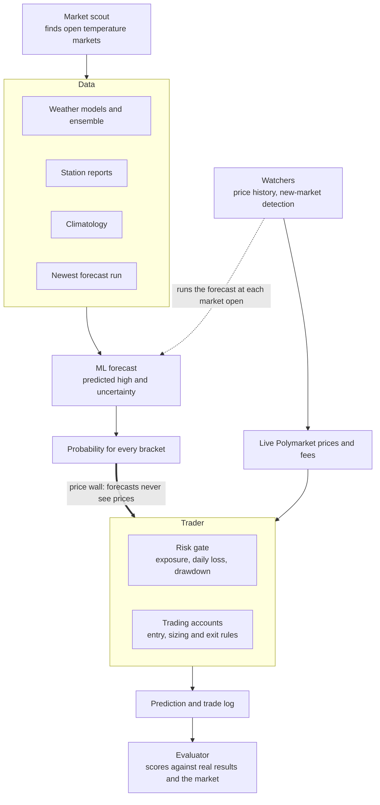

# WeatherAgents

An automated trading system for Polymarket's daily temperature markets. It forecasts each city's daily high, compares its probabilities with the market's prices, and trades the brackets it thinks are mispriced.

It runs continuously against live Polymarket prices and fees. A trading rule moves to real orders only after it passes a test that was written down in advance.

## How it works



**Forecast.** Four weather models, a 119-member ensemble, station readings and climate normals feed a single learned model. It predicts the day's high and its own uncertainty, then converts that into a probability for each one-degree bracket.

**Trader.** For each market it compares the forecast with the live bid and ask, subtracts the spread and Polymarket's fee, and trades only when the edge that remains clears a threshold. Several accounts run different entry and exit rules on the same quotes, each under a risk gate that caps exposure, daily loss and drawdown.

**Market watchers.** They record every bracket's price over time and detect the moment a new market is funded, so a forecast is ready when it opens.

**Evaluator.** Every forecast is logged with the price at that moment and scored against the real result and against the market. Model inputs and trading rules stay only if they improve on data they have not seen.

## Run it

```
uv sync
python -m weatheragents.daily               # scout, forecast, resolve, score
python -m weatheragents.trader --watch 5    # trading accounts
python -m weatheragents.trader --report     # account report
```

Code is in `weatheragents/` and tests are in `tests/`.
